<p align="center">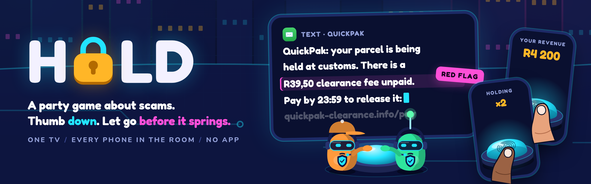</p>

**HOLD** is a party game about scams for a room full of people. One TV shows a message line by line; everyone keeps a thumb on their phone to grow their company's revenue, and lets go before the scam springs.

No app, no accounts: phones join by QR code. One Node server, one dependency.

<p align="center">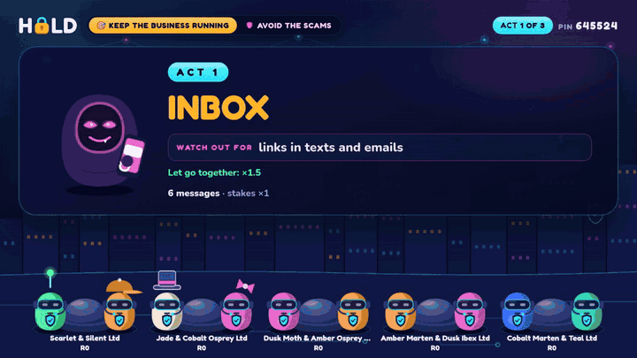</p>

## Run it in 60 seconds

With Node 20 or newer:

```sh
git clone https://github.com/Angelopvtac/hold-game.git && cd hold-game
npm install && BIND=0.0.0.0 npm start
```

It prints two addresses. Open the **TV** one on a big screen; phones on the same wifi scan the QR code it shows.

With Docker:

```sh
git clone https://github.com/Angelopvtac/hold-game.git && cd hold-game
docker compose up -d --build
```

Then open `http://localhost:8080/screen`. Compose binds to `127.0.0.1` by default; to let phones on your wifi join, change the ports line in [`compose.yaml`](compose.yaml) to `"8080:8080"`.

## How to play

1. Open **`/screen`** on the TV. It makes a lobby with a QR code and PIN.
2. Everyone scans the QR (or opens **`/`** and types the PIN).
3. Pair up with the person next to you: one shows a 3-digit code, the other types it. Each pair is a company; anyone left over plays solo, and bots fill a small room.
4. The host presses **START** (`S`).
5. Hold your thumb down while the message plays. A real message: hold to the end for double. A scam: let go before it springs, or lose what you held.

A match is three acts (about 14 minutes) with quizzes, a hot file and a ransomware duel between them, and awards at the end.

**On the TV**

| The lobby | A message plays |
|:-:|:-:|
| 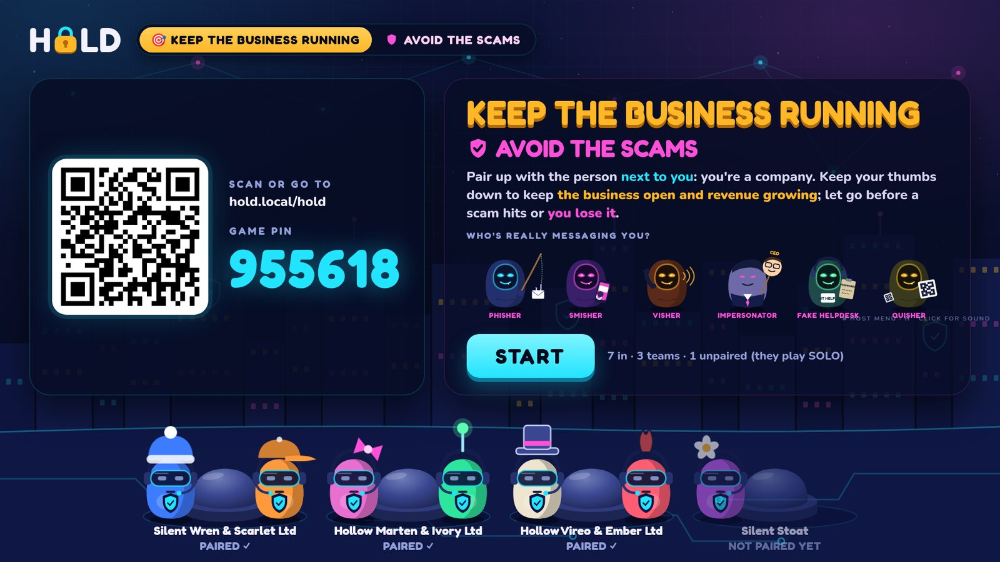 | 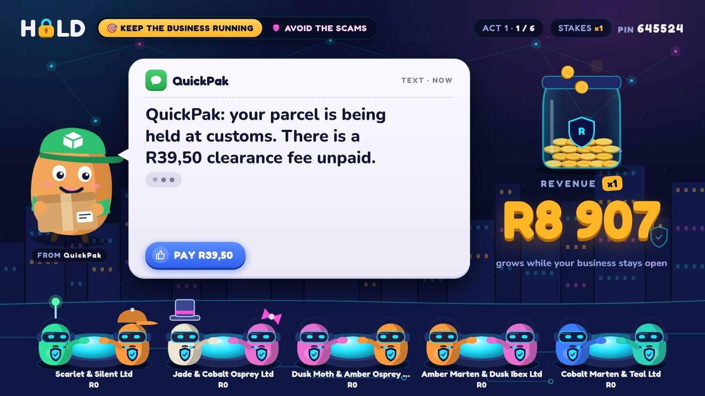 |
| **The scam springs** | **The reveal: who was really behind it** |
| 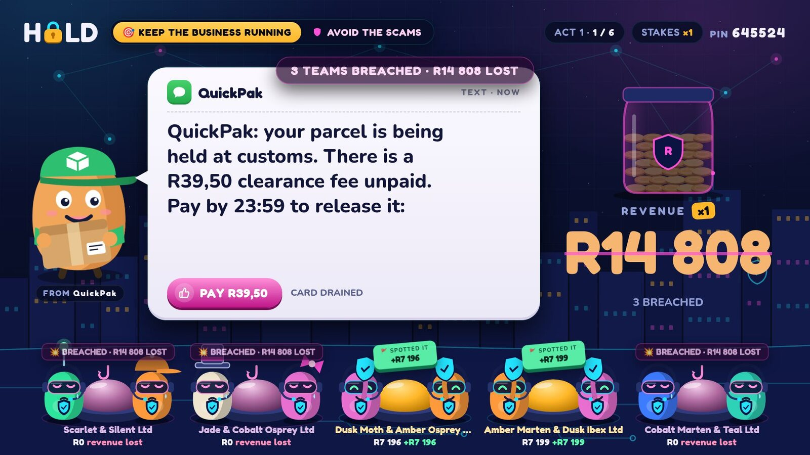 | 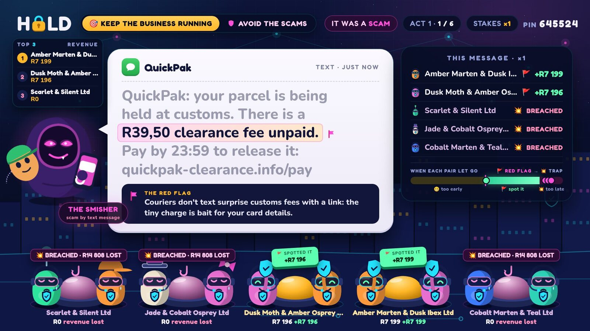 |

**On your phone**

| Pair up | Hold | Caught | Your company report |
|:-:|:-:|:-:|:-:|
| 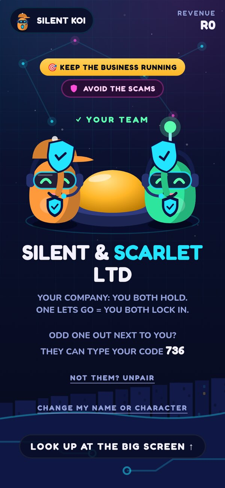 | 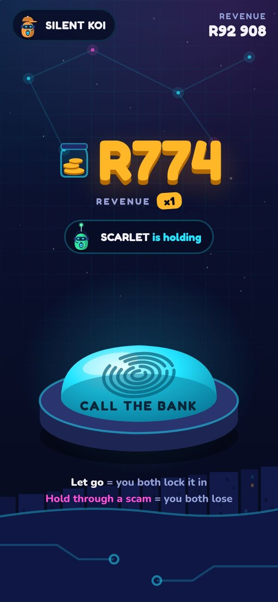 | 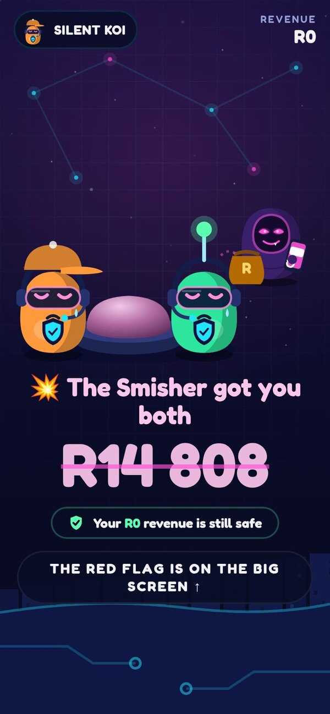 | 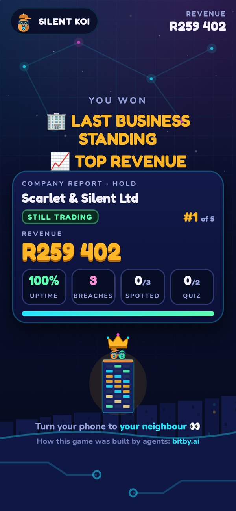 |

<p align="center">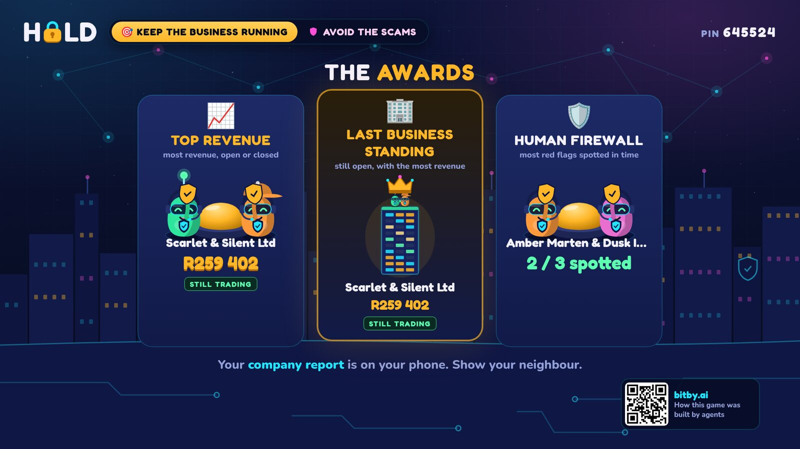</p>

### Host keys (on the TV)

| Key | Does |
|---|---|
| `H` | Open the host menu |
| `S` | Start the match |
| `K` | Skip this step |
| `P` | Pause at the next reveal (again to resume) |
| `W` / `D` | Hot file now / ransomware duel now |
| `E` | End match, straight to the awards (hold 1 s) |
| `N` | New match, same PIN (hold 1 s) |
| `R` | Reset lobby, new PIN (hold 1 s) |
| `M` | Sound on or off |

## Make your own message pack

Messages live in [`data/hold-messages.json`](data/hold-messages.json). Point `HOLD_MESSAGES` at your own file to swap the pack:

```json
{
  "id": "parcel-customs",
  "kind": "scam",
  "sender": "QuickPak",
  "channel": "sms",
  "lines": [
    "QuickPak: your parcel is being",
    "held at customs. There is a",
    "R39,50 clearance fee unpaid.",
    "Pay by 23:59 to release it:",
    "quickpak-clearance.info/pay"
  ],
  "flagLine": 2,
  "springLine": 3,
  "action": "PAY R39,50",
  "consequence": "CARD DRAINED",
  "teach": "Couriers don't text surprise customs fees with a link.",
  "act": 1
}
```

- `kind`: `scam`, `real`, or one `practice` message (played before act 1, not scored).
- `channel`: `sms`, `whatsapp` or `email`. Optional `format`: `phone` (a lock-screen notification) or `web` (a web page).
- `flagLine`: the line (from 0) that gives the scam away; it lights up at the reveal. `springLine`: when the scam fires. Both `null` on a real message.
- `action`: the button the thumb is on (20 characters max). `consequence`: what tapping a scam cost (24 max).
- `act`: 1 to 3. Optional `disguise` (`courier`, `helpdesk`, `bank`, `boss`, `friend`) and `persona` (who was really behind it).

The server checks every pack at startup and names the first problem. `npm run check:messages` also checks the pacing (6 per act, spot windows long enough to react).

Quizzes, incidents and puzzles are in `data/hold-quiz.json`, `data/hold-incidents.json` and `data/hold-puzzles.json`; player name words in `data/names.json`. All senders, companies, people and web addresses in the packs are made up.

## Settings

Environment variables (see [`.env.example`](.env.example)). With Compose, put `PUBLIC_URL`, `TRUST_PROXY`, `ALLOWED_ORIGINS` and `HOLD_MESSAGES` in `.env`.

| Variable | Default | What it does |
|---|---|---|
| `BIND` | `127.0.0.1` | Where the server listens. `0.0.0.0` lets phones on the same wifi join. |
| `PORT` | `8080` | Port. |
| `PUBLIC_URL` | auto | The address in the join QR code. Set it behind a tunnel or reverse proxy. |
| `TRUST_PROXY` | `0` | `1` only behind a reverse proxy that sets `X-Forwarded-For`. |
| `ALLOWED_ORIGINS` | empty | Extra page origins allowed to open the game socket (comma-separated). |
| `HOLD_MESSAGES` | `data/hold-messages.json` | The message pack. |
| `HOLD_QUIZ`, `HOLD_INCIDENTS`, `HOLD_PUZZLES` | `data/…` | The other packs; `off` turns one off. |
| `HOLD_SCALE` | `1` | Game speed. `0.25` runs a match four times faster (for testing). |
| `STATE_DIR` | `state/` | Where the anonymous playtest log goes. |

## Under the hood

- `server/server.js` serves `public/` and hands the socket on `/hold/ws` to `server/hold/hub.js`.
- `server/hold/room.js` owns each lobby: teams, bots, the clock and all scoring. Phones never receive the message text or the answer.
- `public/hold/screen.html` is the TV, `public/hold/play.html` the phone. No build step.
- The server writes an anonymous playtest log (no names) to `STATE_DIR/hold-log.jsonl`; `npm run report` shows which messages people spotted.
- `npm test` plays a full match over real sockets on a fast clock (about 90 s).

## Credits and licence

Fonts: Fredoka and Nunito (SIL Open Font License). QR codes: qrcode-generator by Kazuhiko Arase (MIT).

Built by agents. The write-up is at [bitby.ai](https://bitby.ai).

MIT. See [LICENSE](LICENSE).
