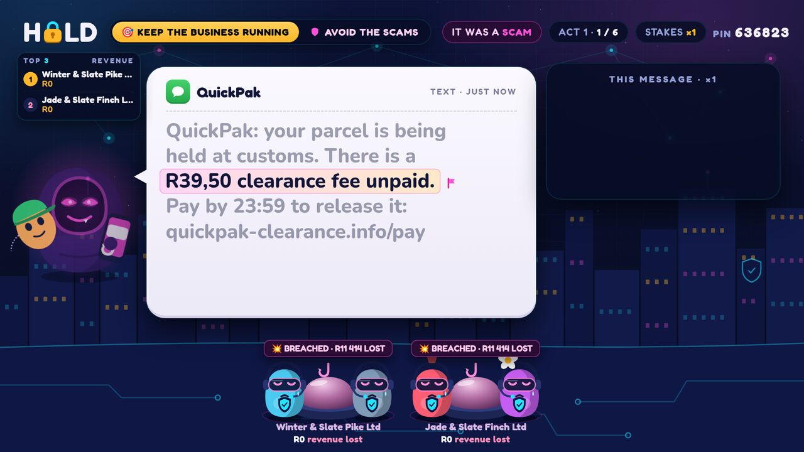
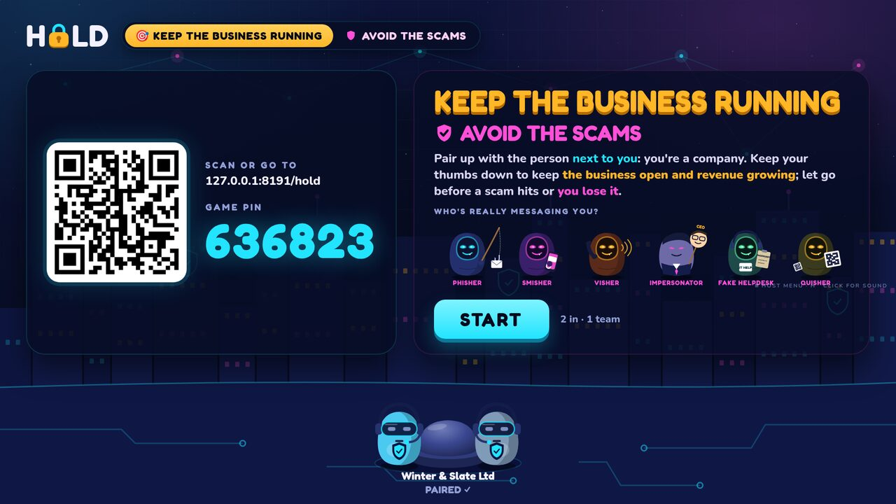

# HOLD

A party game about scams for a room full of people. The TV shows a message line by line; you and your neighbour keep your thumbs down to grow your company's revenue, and let go before the scam springs.



## How to play

1. Open **`/screen`** on the TV or projector. It makes a lobby and shows a QR code and PIN.
2. Everyone scans the QR (or opens **`/`** and types the PIN) on their phone.
3. Pair up with the person next to you by typing their 3-digit code. Each pair is a company; anyone left over plays solo.
4. The host presses **START** (or `S`) on the TV.
5. Hold your thumb on the phone while the message plays. Real message: hold to the end for double. Scam: let go before it springs, or you lose what you held.

A match is three acts (about 14 minutes) with quizzes, a hot file and a ransomware duel between them, and awards at the end.

Host keys on the TV (`H` opens the menu): `S` start, `K` skip, `P` pause, `E` end match, `N` new match, `R` reset lobby (new PIN). E, N and R must be held for a second.



## Quick start

With Docker:

```sh
docker compose up -d --build
# TV:     http://localhost:8080/screen
# Phones: http://<your computer's LAN address>:8080/
```

Compose binds to `127.0.0.1` by default. For phones on your wifi to join, change the ports line in `compose.yaml` to `"8080:8080"`.

With Node 20+:

```sh
npm install
BIND=0.0.0.0 npm start     # prints the TV and phone addresses
npm test                   # full match over real sockets on a fast clock (about 90 s)
```

Settings are environment variables; see [`.env.example`](.env.example). If the game sits behind a tunnel or reverse proxy, set `PUBLIC_URL` so the QR code points at the right address.

## Adding messages

Messages live in [`data/hold-messages.json`](data/hold-messages.json). Point `HOLD_MESSAGES` at another file to use your own pack. Each entry looks like this:

```json
{
  "id": "parcel-customs",
  "kind": "scam",
  "sender": "QuickPak",
  "channel": "sms",
  "lines": [
    "QuickPak: your parcel is being",
    "held at customs. There is a",
    "R39,50 clearance fee unpaid.",
    "Pay by 23:59 to release it:",
    "quickpak-clearance.info/pay"
  ],
  "flagLine": 2,
  "springLine": 3,
  "action": "PAY R39,50",
  "consequence": "CARD DRAINED",
  "teach": "Couriers don't text surprise customs fees with a link.",
  "act": 1
}
```

- `kind`: `scam`, `real`, or one `practice` message (played before act 1, not scored).
- `channel`: `sms`, `whatsapp` or `email`. Optional `format`: `phone` (a lock-screen notification) or `web` (a web page).
- `flagLine`: the line (from 0) that gives the scam away; it lights up at the reveal. `springLine`: when the scam fires. Both `null` on a real message.
- `action`: the button the thumb is on (20 characters max). `consequence`: what tapping a scam cost (24 max).
- `act`: 1 to 3. Optional `disguise` (`courier`, `helpdesk`, `bank`, `boss`, `friend`) and `persona` (who was really behind it).

The server checks every pack at startup and names the first problem. `npm run check:messages` also checks a pack against the game's pacing (6 per act, spot windows long enough to react).

Quiz questions, incidents and puzzles are in `data/hold-quiz.json`, `data/hold-incidents.json` and `data/hold-puzzles.json` (`HOLD_QUIZ`, `HOLD_INCIDENTS`, `HOLD_PUZZLES` to swap them). Player name words are in `data/names.json`.

All senders, companies, people and web addresses in the packs are made up.

## How it works

- `server/server.js` serves `public/` and hands the socket on `/hold/ws` to `server/hold/hub.js`.
- `server/hold/room.js` owns each lobby: teams, bots, the clock and all scoring. Phones never receive the message text or the answer.
- `public/hold/screen.html` is the TV, `public/hold/play.html` the phone. No build step, one dependency (`ws`).
- The server writes an anonymous playtest log (no names) to `STATE_DIR/hold-log.jsonl`; `npm run report` shows which messages people spotted.

## Credits

Fonts: Fredoka and Nunito (SIL Open Font License). QR codes: qrcode-generator by Kazuhiko Arase (MIT).

## Licence

MIT. See [LICENSE](LICENSE).
